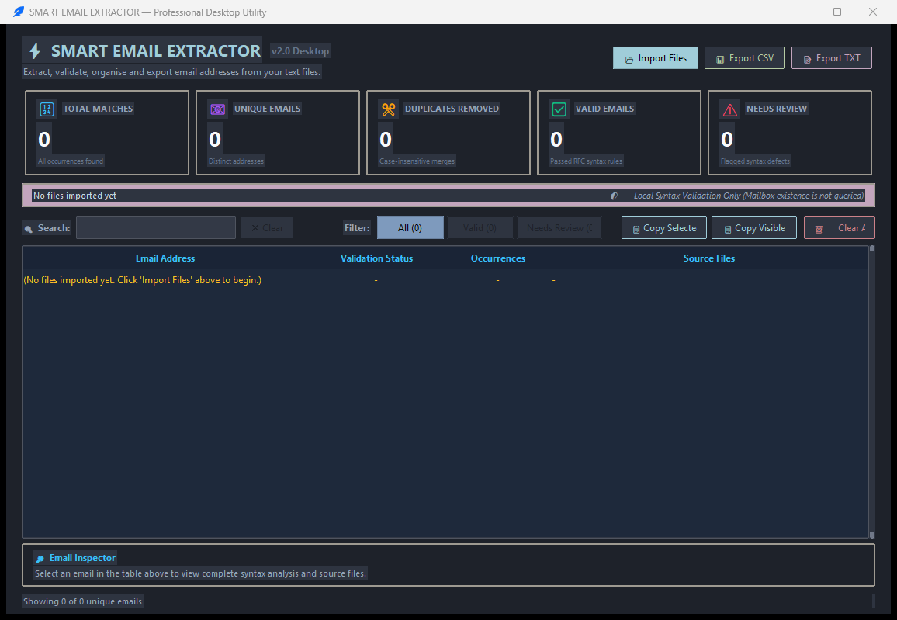
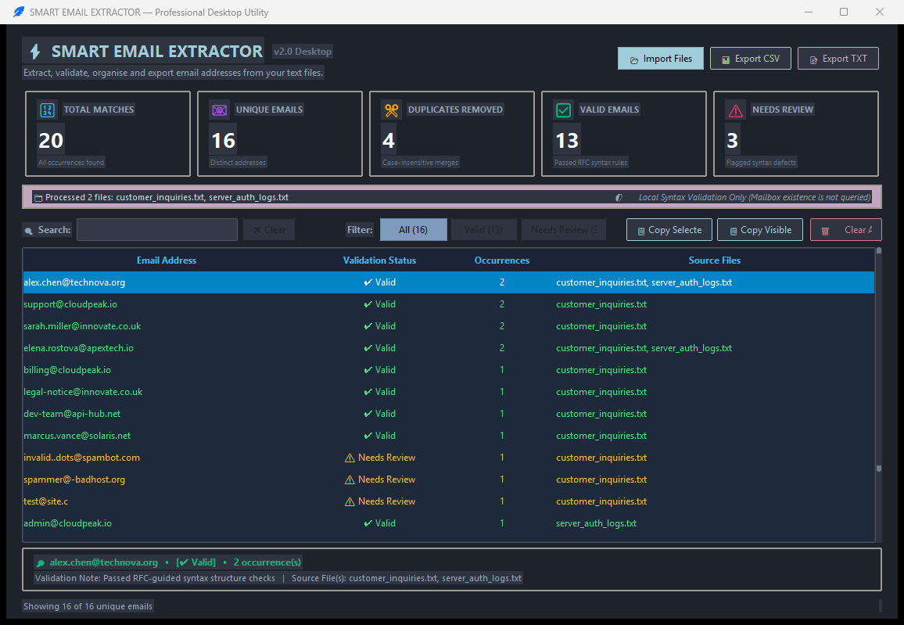
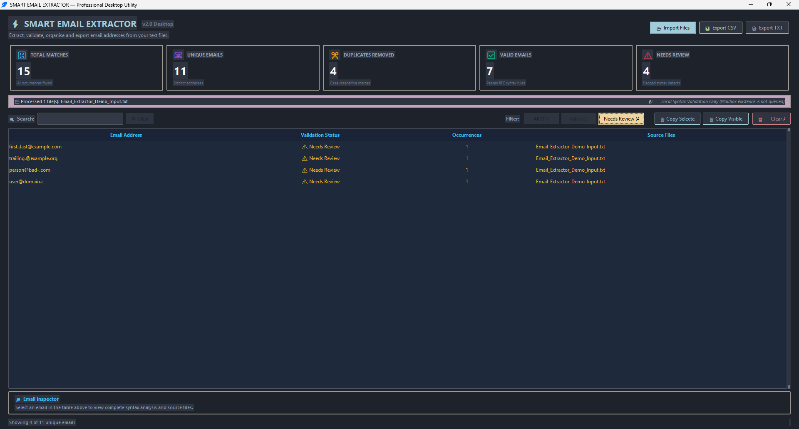
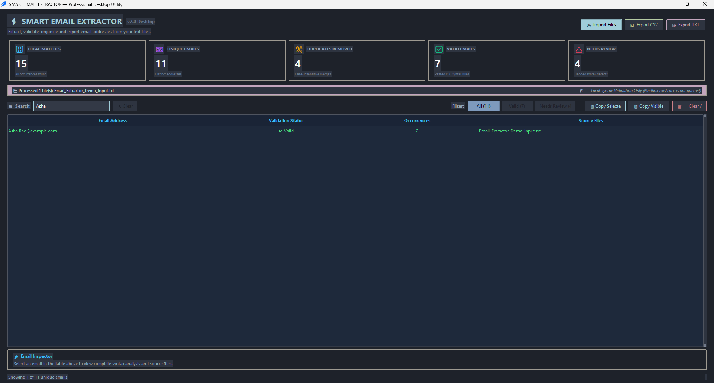
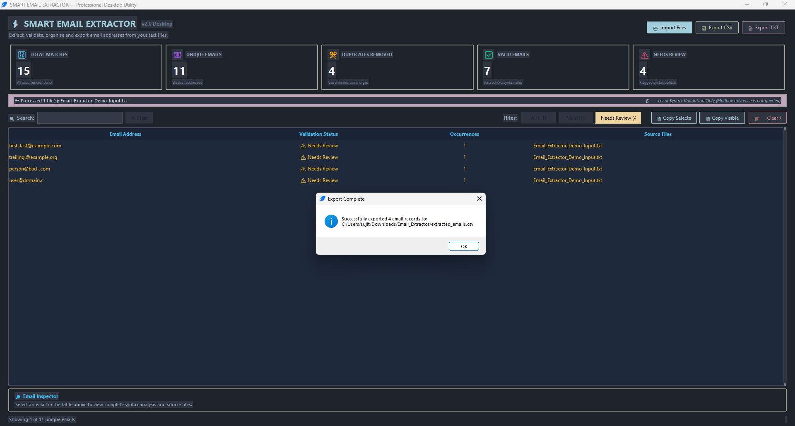
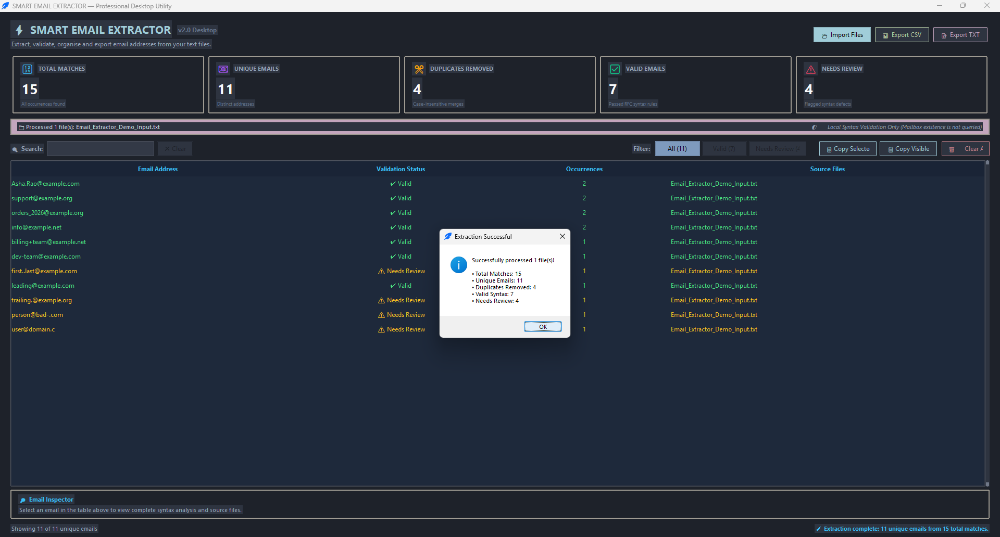

# 📧 Smart Email Extractor — Python Desktop Application

A modern, polished, and beginner-friendly **Smart Email Extraction Desktop Utility** developed in Python using Tkinter and `ttkbootstrap`. Built as an advanced enhancement to the **CodeAlpha Python Programming Internship (Task 3: Automation Script / Email Extractor)**, this project transitions the original console-based text script into a full-featured desktop dashboard featuring live syntax validation, case-insensitive deduplication, real-time statistics cards, search-as-you-type filtering, multi-format CSV/TXT export, and operating system clipboard integration.

---

## 🎯 1. Project Objectives

* **Desktop Task Automation:** Automate the repetitive extraction of email contact information from unstructured text documents into structured formats.
* **Batch Document Ingestion:** Allow users to import single or multiple text files (`.txt`, `.log`, `.csv`) simultaneously with multi-encoding resilience (`utf-8`, `cp1252`, `latin-1`).
* **Noise & Punctuation Normalization:** Accurately strip sentence-ending periods, commas, colons, angle brackets (`<user@domain.com>`), quotes, and `mailto:` link prefixes.
* **Intelligent Deduplication:** Identify duplicate addresses regardless of letter-case variations (`User@Domain.com` vs `user@domain.com`) while preserving original first-seen casing and tracking occurrence frequencies.
* **Multi-Rule Syntax Diagnostics:** Evaluate candidates locally against 14 RFC-guided structural syntax rules to isolate malformed addresses for user review.
* **Export Flexibility:** Export sanitized results into RFC-compliant CSV files, plain newline-delimited TXT files, or direct to the system clipboard.

---

## ✨ 2. Main Features

### 📊 Modern Dark-Themed Dashboard (`nord-dark`)
* **Single-Window Ergonomics:** Responsive, non-flickering window layout with zero duplicate popup windows.
* **Live Analytics Cards:**
  * **🔢 Total Matches:** Aggregate count of all extracted email candidates (including duplicate occurrences).
  * **📧 Unique Emails:** Count of distinct email addresses (case-insensitively deduplicated).
  * **✂️ Duplicates Removed:** Count of redundant email occurrences eliminated (`Total Matches - Unique Emails`).
  * **✅ Valid Emails:** Addresses that satisfy all 14 RFC-guided structural syntax rules.
  * **⚠️ Needs Review:** Candidates flagged with syntax or formatting defects.

### ⚡ Precision Email Extraction Engine
* **Boundary Normalization:** Correctly strips sentence-ending periods, commas, colons, semicolons, exclamation marks, question marks, quotation marks, parentheses, and angle brackets (`<user@example.com>` → `user@example.com`).
* **Mailto Link Handling:** Automatically strips HTML/Markdown `mailto:` link prefixes.
* **Case-Insensitive Deduplication:** Identifies identical addresses regardless of letter-case variations while retaining the first-seen casing.
* **Multi-Source Attribution:** Records occurrence counts and tracks which specific imported documents contained each address.

### 🛡️ RFC-Guided Local Syntax Validation
Every extracted candidate is evaluated locally against 14 structural syntax rules:
1. Candidate string non-empty.
2. Total address length within RFC maximum (≤ 254 characters).
3. Presence of exactly one `@` symbol.
4. Non-empty local-part and non-empty domain.
5. Local-part length limit (≤ 64 characters).
6. Domain length limit (≤ 255 characters).
7. No consecutive dots (`..`) in local-part or domain.
8. No leading or trailing dots in local-part or domain.
9. Local-part contains only allowed RFC characters.
10. Domain contains at least two labels (domain name + TLD).
11. Domain labels do not exceed 63 characters each.
12. Domain labels consist of alphanumeric characters and hyphens only.
13. Domain labels do not begin or end with a hyphen.
14. Top-level domain (TLD) is at least 2 alphabetic characters (or valid punycode).

### 📋 Interactive Results Table & Toolbar
* **Search-as-you-Type:** Dynamic real-time search matching email address strings, domain names, source filenames, or validation failure notes.
* **Category Filter Pills:** Instantaneously isolate `All`, `Valid`, or `Needs Review` candidates with one click.
* **Interactive Column Sorting:** Click any column header (`Email Address`, `Validation Status`, `Occurrences`, `Source Files`) to toggle ascending/descending order.
* **Detail Inspector Panel:** Selecting any row in the table immediately surfaces its detailed syntax diagnostics and complete list of source files.

### 💾 Multi-Format Export & Clipboard Actions
* **📊 RFC-Compliant CSV Export:** Exports `Email Address`, `Validation Status`, `Occurrences`, `Source Files`, and `Validation Notes` with proper quoting.
* **📝 Plain TXT Export:** Exports clean, unique email addresses, one address per line.
* **Filtered Exports:** Exports apply strictly to the currently visible filtered results, enabling targeted output.
* **📋 Clipboard Integration:** One-click shortcuts to copy either selected rows or all visible addresses directly to the clipboard.

---

## 📸 3. Screenshots

| Welcome Dashboard (Initial State) | Extraction Results & Live Metrics |
|:---:|:---:|
|  |  |

| Category Validation Filtering | Real-Time Search Functionality |
|:---:|:---:|
|  |  |

| CSV Export Confirmation Dialog | Multi-File Batch Extraction Success |
|:---:|:---:|
|  |  |

---

## 🛠️ 4. Technologies Used

* **Language:** Python 3.10+ (tested on Python 3.14)
* **Desktop GUI Engine:** Python Standard Library `tkinter` and `ttk`
* **Modern Theming Engine:** `ttkbootstrap` (Nord-dark theme with custom high-contrast enhancements)
* **Pattern Matching:** Python Standard Library `re` (Regular Expressions)
* **File Operations:** Python Standard Library `csv`, `os`, `pathlib`
* **Test Automation:** Python Standard Library `unittest`

---

## 🏛️ 5. Application Architecture

The utility implements a clear separation between parsing logic, file I/O, and user interface:

```
┌────────────────────────────────────────────────────────┐
│                   app.py (Launcher)                    │
└───────────────────────────┬────────────────────────────┘
                            │
                            ▼
┌────────────────────────────────────────────────────────┐
│                    src/ui.py (GUI)                     │
│ - SmartEmailExtractorUI                                │
│ - Metric Cards (Total, Unique, Duplicates, Valid, Flag)│
│ - Search-as-you-type Filter & Category Pills           │
│ - Interactive Treeview & Detail Inspector              │
└─────────────┬────────────────────────────┬─────────────┘
              │                            │
              ▼                            ▼
┌───────────────────────────┐ ┌──────────────────────────┐
│ src/email_engine.py (Core)│ │src/file_operations.py    │
│ - EmailExtractionEngine   │ │ - Multi-encoding Reader  │
│ - Boundary Normalization  │ │ - Batch File Processor   │
│ - Case-Insensitive Dedup  │ │ - RFC CSV Exporter       │
│ - 14-Rule Syntax Validator│ │ - Newline TXT Exporter   │
└───────────────────────────┘ └──────────────────────────┘
```

---

## 📁 6. Directory Structure

```text
Email_Extractor/
│
├── assets/
│   └── .gitkeep                 # Visual assets and application icons
│
├── data/                        # Fictional demonstration datasets
│   ├── customer_inquiries.txt   # Sample customer ticket log
│   └── server_auth_logs.txt     # Sample server authentication log
│
├── reference/
│   └── Email extract.txt        # Original byte-verified assignment text file
│
├── screenshots/                 # Application interface screenshots
│   ├── csv_export_confirmation.png
│   ├── extraction_results.png
│   ├── extraction_success.png
│   ├── Search_Functionality.png
│   ├── Validation_Filter.png
│   └── welcome_dashboard.png
│
├── src/
│   ├── __init__.py
│   ├── email_engine.py          # Extraction engine & 14-rule syntax validation
│   ├── file_operations.py       # Multi-encoding file readers & CSV/TXT exporters
│   └── ui.py                    # Tkinter + ttkbootstrap graphical dashboard
│
├── tests/
│   ├── __init__.py
│   ├── test_email_engine.py     # Unit tests for extraction & syntax validation
│   ├── test_file_operations.py  # Unit tests for file readers & exporters
│   └── test_ui_workflow.py      # Integration tests for UI lifecycle & search
│
├── app.py                       # Main application entry point
├── Run_Email_Extractor.bat      # Windows batch launcher
├── requirements.txt             # Python dependencies
├── .gitignore                   # Project-level Git exclusion rules
└── README.md                    # Comprehensive documentation
```

---

## 📥 7. Installation Instructions

1. **Navigate to the project directory:**
   ```powershell
   cd Email_Extractor
   ```

2. **(Recommended) Create and activate a virtual environment:**
   ```powershell
   python -m venv .venv
   .\.venv\Scripts\Activate.ps1
   ```

3. **Install dependencies:**
   ```powershell
   python -m pip install -r requirements.txt
   ```

---

## 🚀 8. Running Instructions

### Direct Python Execution
```powershell
python app.py
```

### Windows Batch Launcher
Double-click `Run_Email_Extractor.bat` from Windows Explorer or execute from terminal:
```cmd
Run_Email_Extractor.bat
```
The launcher sets the local project directory, detects Python, and launches the application cleanly.

---

## 🧪 9. Testing Instructions

The project includes an automated test suite with 34 comprehensive unit and integration tests.

Run tests using `unittest`:
```powershell
python -m unittest discover -s tests -v
```

### Verified Test Areas
* **Extraction & Deduplication (`test_email_engine.py`):** Ordinary address matching, punctuation boundary stripping (dots, quotes, brackets), case-insensitive deduplication, preserving first-seen casing, multi-file source tracking, empty input resilience.
* **Syntax Validation (`test_email_engine.py`):** Candidate length limits, single `@` constraint, missing local part or domain, consecutive dots, leading/trailing dots, invalid domain label characters, TLD validity.
* **File Operations (`test_file_operations.py`):** Multi-encoding reading (`utf-8`, `cp1252`, `latin-1`), empty file handling, batch reading of mixed valid/invalid files, RFC-compliant CSV exports, and plain TXT exports.
* **UI Workflows (`test_ui_workflow.py`):** Zero-state initialization, live metric card updates, search-as-you-type filtering, category filter pills, column sorting, and inspector selection.

---

## ⚠️ 10. Limitations

> [!IMPORTANT]
> **Email Validation Scope & Limitations:**
> This utility evaluates **structural syntax and formatting rules only** based on RFC specifications. It does **NOT** verify whether an email account actually exists, whether a mailbox is currently active, whether the domain accepts mail, or whether an address is deliverable. No external network API calls, ping operations, or DNS MX lookups are made.

* **Local File Processing:** Operates strictly on local text-based documents (`.txt`, `.log`, `.csv`, `.json`); proprietary binary document formats (`.pdf`, `.docx`) must be converted to plain text prior to extraction.
* **Offline Execution:** The application does not connect to third-party verification web services, preserving user data privacy.
