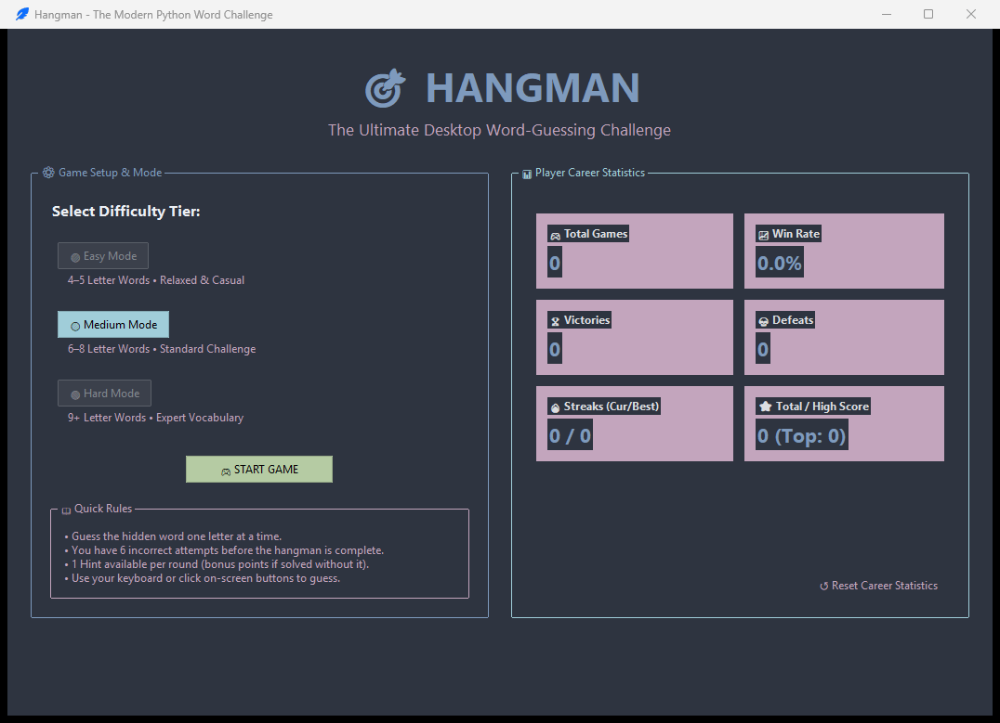
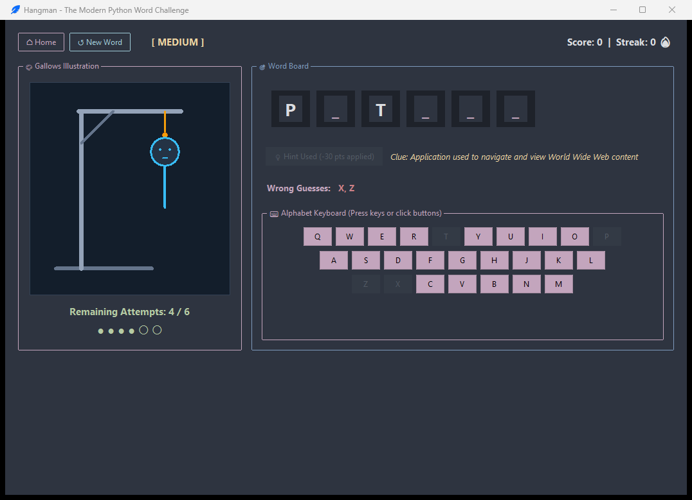
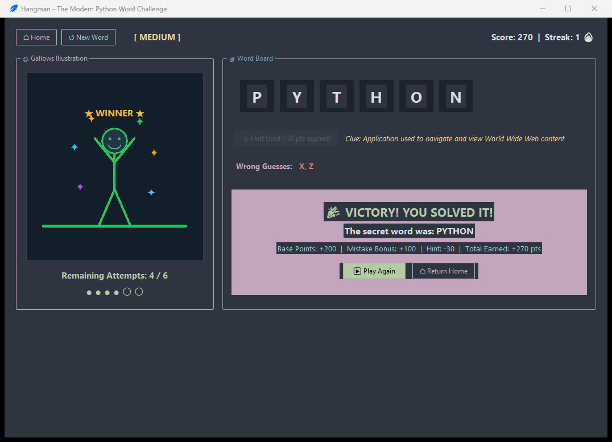

# 🎯 Hangman Desktop Game

A modern, polished dark-themed desktop Hangman game built with Python, Tkinter, and ttkbootstrap. Featuring progressive canvas animations, interactive keyboard input, dynamic difficulty tiers, real-time score tracking, and persistent career statistics.

---

## 📸 Screenshots

| Welcome & Statistics Dashboard | Gameplay Screen |
|:---:|:---:|
|  |  |

| Victory Celebration |
|:---:|
|  |

---

## ✨ Features

- **Gaming Dashboard Theme**:
  - Immersive dark navy palette powered by modern `ttkbootstrap` themes.
  - High-contrast text, sleek cards, and color-coded status badges.
  - Single-window navigation ensuring zero duplicate popup windows.

- **Dynamic Difficulty Tiers**:
  - 🟢 **Easy**: 4–5 letter words, casual & beginner-friendly.
  - 🟡 **Medium**: 6–8 letter words, standard balanced challenge.
  - 🔴 **Hard**: 9+ letter words, expert technical and vocabulary challenge.
  - **No-Repeat System**: Automatically avoids repeating the immediately previous word when alternatives exist.

- **Dual Input Guessing System**:
  - **Interactive On-Screen Keyboard**: Full QWERTY layout with color-coded feedback (green for correct, red for incorrect, auto-disabled).
  - **Physical Keyboard Support**: Direct typing with real-time `<Key>` event handling.
  - Repeated guess protection without loss of attempts.
  - Input validation rejecting numbers, special characters, and multi-letter entries.

- **Progressive Canvas Hangman Animation**:
  - Custom Tkinter Canvas rendering the gallows (platform, upright post, beam, brace, rope, and noose).
  - 6-stage progressive body reveal:
    1. Head (with expressive face)
    2. Torso
    3. Left Arm
    4. Right Arm
    5. Left Leg
    6. Right Leg
  - **Dynamic Outcome Art**:
    - **Defeat**: Red "X X" dead eyes, frown, and answer reveal.
    - **Victory**: Cheerful smiling stick figure standing free on the grass with arms raised in victory and celebratory sparkles.

- **Contextual Hint System**:
  - 1 contextual, educational clue per round.
  - Clearly indicates when used with a slight score deduction penalty (-30 pts).

- **Scoring & Career Statistics**:
  - Base points per difficulty: Easy (100), Medium (200), Hard (300).
  - Flawless mistake bonus: +25 points per remaining attempt.
  - Persistent tracking: Total games, wins, losses, win percentage, current streak, best streak, high score, and total score.
  - Saved locally in `data/stats.json`. Corrupted or missing files are safely recovered with clean defaults.

---

## 🛠️ Technology Stack

- **Language**: Python 3.10+ (tested on Python 3.14)
- **GUI Toolkit**: Tkinter (Desktop interface)
- **Styling**: `ttkbootstrap` (Modern theme engine)
- **Graphics**: Tkinter Canvas (Vector drawing for gallows and stick figure)
- **Persistence**: JSON (`data/stats.json`)
- **Testing**: Python standard library `unittest`

---

## 📁 Project Structure

```text
Hangman_Game/
│
├── reference/
│   └── Hangman_Original.txt    # Original internship implementation (untouched)
│
├── assets/                     # Icons and static media resources
│
├── screenshots/                # Visual previews of the application
│   ├── welcome_dashboard.png
│   ├── gameplay_screen.png
│   └── victory_screen.png
│
├── data/
│   └── stats.json              # Local persistent player statistics
│
├── src/
│   ├── __init__.py             # Source package initializer
│   ├── game_logic.py           # Core game rules, word bank, guessing & scoring
│   ├── statistics.py           # JSON file persistence and metric calculations
│   └── ui.py                   # Welcome & Gameplay views, canvas art, controls
│
├── tests/
│   ├── __init__.py
│   ├── test_game_logic.py      # Unit tests for game rules and mechanics
│   ├── test_statistics.py      # Unit tests for statistics and recovery
│   └── test_ui_workflow.py     # Integration tests for UI events and transitions
│
├── app.py                      # Application launcher and entry point
├── requirements.txt            # Project dependencies
├── .gitignore                  # Git exclusions for virtual environments and cache
└── README.md                   # Comprehensive documentation
```

---

## 📥 Installation

1. **Clone or navigate to the project directory**:
   ```powershell
   cd C:\Users\sujit\Downloads\Hangman_Game
   ```

2. **(Optional) Create and activate a virtual environment**:
   ```powershell
   python -m venv .venv
   .\.venv\Scripts\Activate.ps1
   ```

3. **Install required dependencies**:
   ```powershell
   python -m pip install -r requirements.txt
   ```

---

## 🚀 Execution

To start the Hangman application:

```powershell
python app.py
```

---

## 📜 Game Rules

1. **Objective**: Discover the secret word before making 6 incorrect guesses.
2. **Guessing**:
   - Choose a letter using the on-screen QWERTY keyboard or your physical keyboard.
   - If the letter exists in the secret word, all matching slots are revealed.
   - If the letter is not in the word, one part of the hangman is drawn and your attempt count decreases.
3. **Attempts**:
   - You begin each round with **6 attempts**.
   - Repeated guesses are blocked and will not deduct attempts.
4. **Hints**:
   - Click the **💡 Need a Hint?** button for an educational clue.
   - Using a hint applies a small -30 point penalty to the round total.
5. **Winning & Losing**:
   - Reveal all letters to win points and extend your winning streak!
   - If all 6 attempts are exhausted, the round is lost and the correct answer is revealed.
