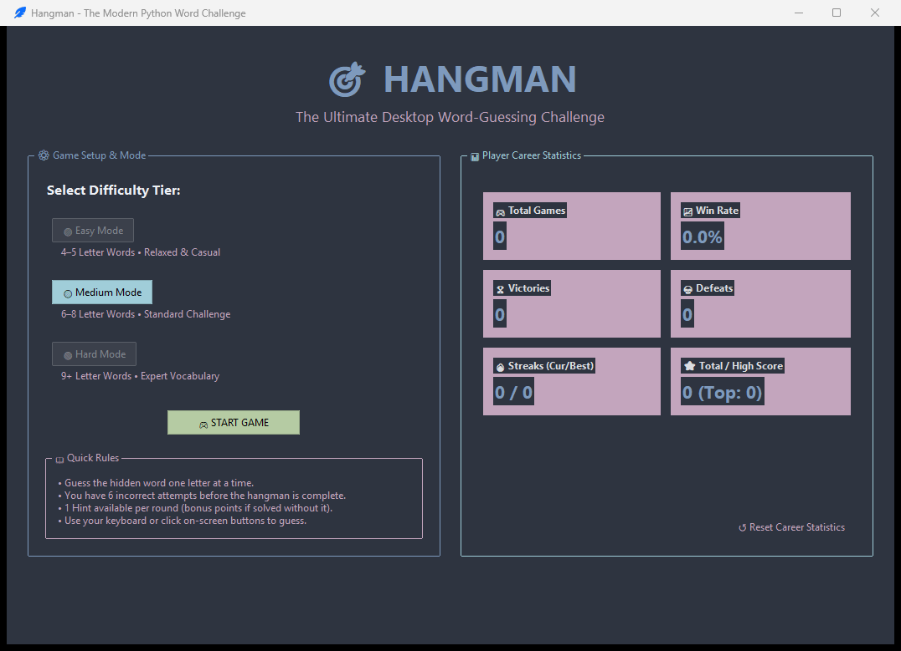
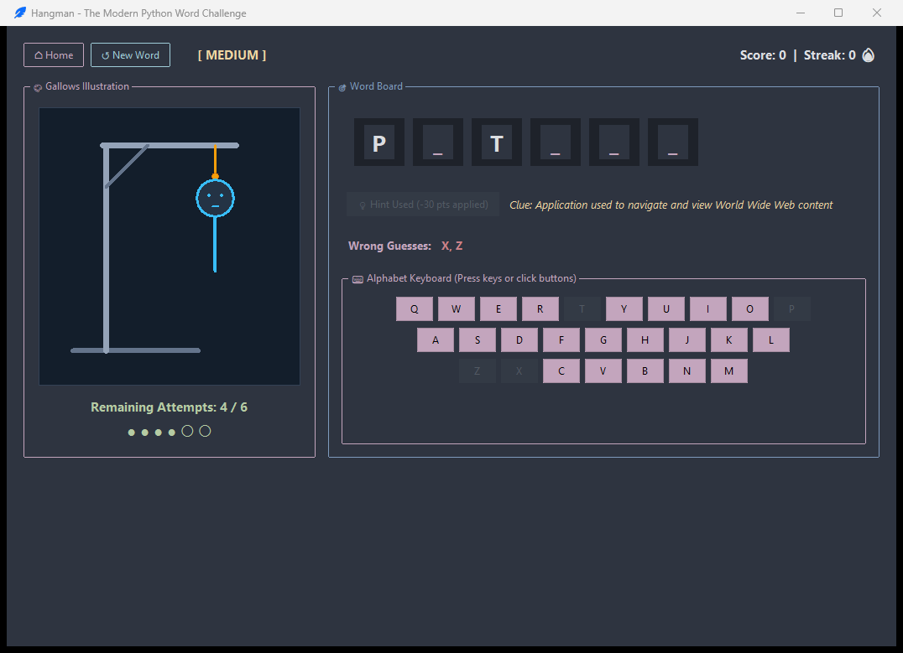
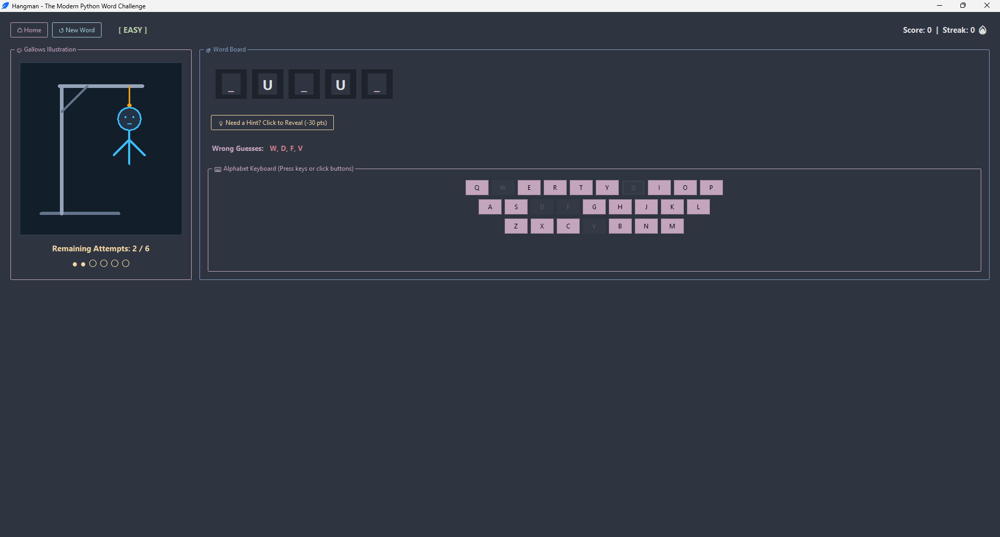
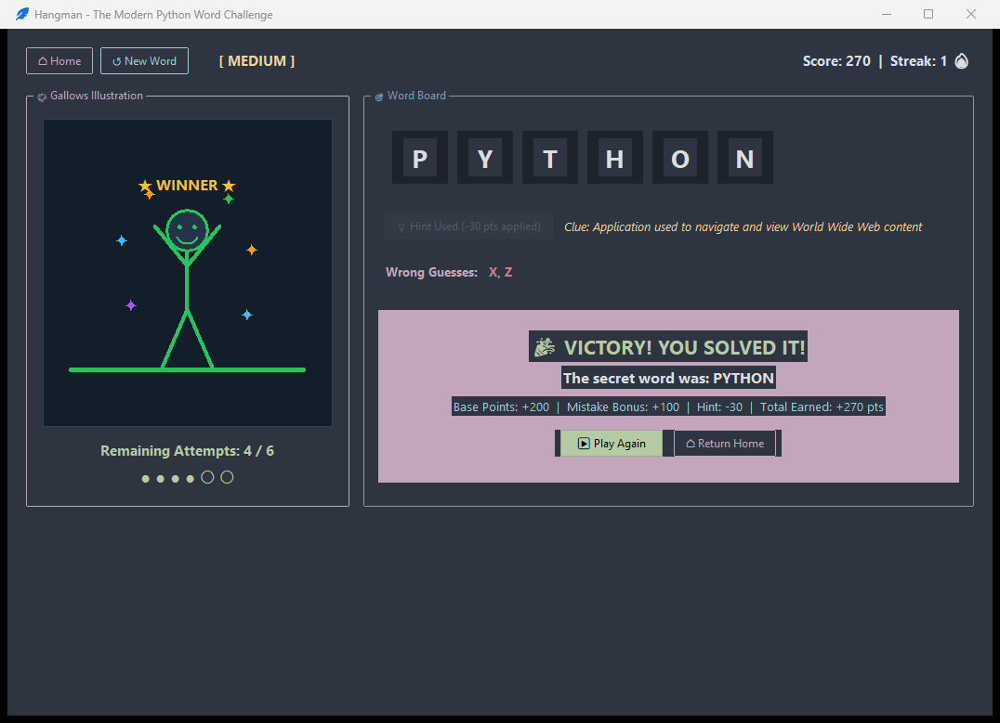
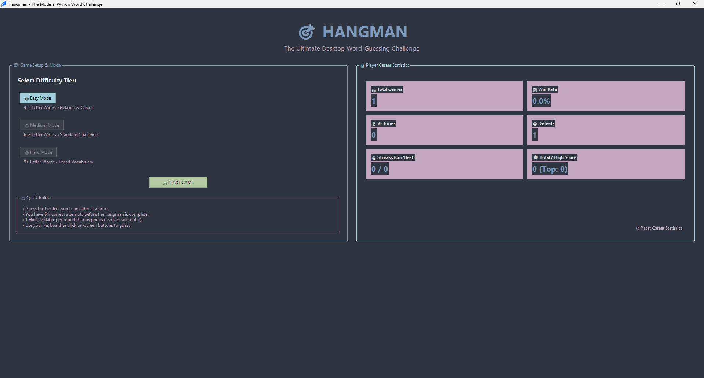

# 🎯 Hangman Desktop Game

A modern, polished dark-themed desktop Hangman game developed in Python using Tkinter and `ttkbootstrap`. Designed as an advanced evolution of the **CodeAlpha Python Programming Internship (Task 1: Hangman Game)**, this application transitions the original basic text loop into an engaging graphical dashboard featuring real-time vector canvas rendering, interactive on-screen and physical keyboard controls, dynamic difficulty tiers, educational hint mechanics, and persistent career statistics.

---

## 🎯 1. Project Objectives

* **Core Gameplay Engineering:** Implement a classic word-guessing game with deterministic state transitions, mistake tracking, and round evaluation.
* **Modern Desktop User Interface:** Provide a single-window GUI with responsive dark-themed styling, clear visual hierarchy, and zero popup clutter.
* **Vector Graphics Rendering:** Draw progressive gallows and character stages dynamically using the Tkinter Canvas API rather than static image assets.
* **Dual Input Ergonomics:** Allow simultaneous physical keyboard input (`<Key>` events) and interactive mouse-clickable on-screen QWERTY buttons.
* **Career Analytics & State Persistence:** Persist player wins, losses, win rates, winning streaks, and high scores across application restarts using JSON.
* **Automated Test Coverage:** Validate game mechanics, input sanitization, word selection, scoring formulas, and UI lifecycle through automated tests.

---

## ✨ 2. Main Features

### 🔤 Dynamic Difficulty Tiers & Word Selection
* 🟢 **Easy Tier (4–5 letters):** Common, beginner-friendly vocabulary.
* 🟡 **Medium Tier (6–8 letters):** Balanced standard challenge words.
* 🔴 **Hard Tier (9+ letters):** Advanced technical and academic vocabulary.
* **No-Repeat System:** Automatically avoids selecting the immediately preceding word when alternative candidates exist in the bank.

### 🎮 Dual Input Controls (Keyboard & Mouse)
* **Physical Keyboard Binding:** Seamlessly captures keystrokes (`a-z`, `A-Z`) via Tkinter event bindings.
* **On-Screen QWERTY Keyboard:** Color-coded button grid indicating letter status (green for correct, red for incorrect, disabled upon guess).
* **Input Validation:** Gracefully filters out special characters, numbers, whitespace, and repeated guesses without penalizing remaining attempts.

### 🎨 6-Stage Progressive Canvas Hangman Rendering
Custom vector graphics drawn dynamically on a dedicated `Canvas`:
1. Gallows base platform, upright post, support beam, and noose rope.
2. Stage 1: Head with expressive facial features.
3. Stage 2: Torso.
4. Stage 3: Left arm.
5. Stage 4: Right arm.
6. Stage 5: Left leg.
7. Stage 6: Right leg.
* **Victory Handling:** Triggered upon revealing all letters; renders a celebratory standing figure on grass with raised arms, animated confetti, and streak bonus notifications.
* **Defeat Handling:** Triggered upon exhausting all 6 attempts; renders dead "X X" eyes, reveals the correct secret word, and updates career losses.

### 💡 Contextual Hint System
* Provides one educational clue per round describing the secret word's definition or usage context.
* Clearly indicates when used and applies a small score penalty (-30 points) to encourage strategic problem-solving.

### 🏆 Scoring Formula & Persistent Career Statistics
* **Scoring Rules:** Base points by difficulty (Easy: 100, Medium: 200, Hard: 300) + Remaining attempt bonus (+25 points per leftover attempt) - Hint deduction (-30 points if used).
* **Persistent Statistics (`data/stats.json`):** Tracks Total Games, Wins, Losses, Win Percentage, Current Streak, Best Streak, High Score, and Total Score.
* **Resilience:** Automatic fallback and schema reconstruction if `stats.json` is missing or corrupted.

---

## 📸 3. Screenshots

| Welcome & Career Dashboard | Active Gameplay View |
|:---:|:---:|
|  |  |

| Progressive Canvas Drawing | Victory Celebration |
|:---:|:---:|
|  |  |

| Player Career Statistics |
|:---:|
|  |

---

## 🛠️ 4. Technologies Used

* **Language:** Python 3.10+ (tested on Python 3.14)
* **Desktop GUI Engine:** Python Standard Library `tkinter`
* **Modern Theming Engine:** `ttkbootstrap` (Dark navy / superhero palette)
* **Vector Rendering:** Tkinter `Canvas` API
* **Data Persistence:** Python Standard Library `json`
* **Test Automation:** Python Standard Library `unittest`

---

## 🏛️ 5. Application Architecture

The application adopts a modular, decoupled architecture:

```
┌────────────────────────────────────────────────────────┐
│                   app.py (Launcher)                    │
└───────────────────────────┬────────────────────────────┘
                            │
              ┌─────────────┴─────────────┐
              ▼                           ▼
┌───────────────────────────┐ ┌───────────────────────────┐
│     src/ui.py (View)      │ │ src/statistics.py (Model) │
│ - WelcomeDashboardView    │ │ - StatsManager            │
│ - GamePlayView            │ │ - JSON file I/O           │
│ - HangmanCanvas (Vector)  │ │ - Fault-tolerant recovery │
│ - QWERTY Keyboard Grid    │ └─────────────▲─────────────┘
└─────────────┬─────────────┘               │
              │                             │
              ▼                             │
┌───────────────────────────────────────────┴─────────────┐
│              src/game_logic.py (Controller)             │
│ - WordBank & Difficulty Tiers                           │
│ - Guess Validation & Attempt Management                 │
│ - Scoring Calculations & Hint Mechanics                 │
└─────────────────────────────────────────────────────────┘
```

---

## 📁 6. Directory Structure

```text
Hangman_Game/
│
├── assets/
│   └── .gitkeep                 # Visual resources and application icons
│
├── data/
│   └── .gitkeep                 # Directory for persistent JSON statistics (auto-generated)
│
├── reference/
│   ├── Hangman_Original.txt     # Original CodeAlpha assignment text file
│   └── Hangman game.txt         # Byte-for-byte verified assignment source
│
├── screenshots/                 # Application interface screenshots
│   ├── gameplay_screen.png
│   ├── player_statistics.png
│   ├── progressive_drawing.png
│   ├── victory_screen.png
│   └── welcome_dashboard.png
│
├── src/
│   ├── __init__.py
│   ├── game_logic.py            # Word selection, difficulties, scoring & game state
│   ├── statistics.py            # JSON persistence and statistics calculations
│   └── ui.py                    # Views, canvas art engine, keyboard events
│
├── tests/
│   ├── __init__.py
│   ├── test_game_logic.py       # Unit tests for game rules and mechanics
│   ├── test_statistics.py       # Unit tests for stats persistence and error recovery
│   └── test_ui_workflow.py      # Integration tests for UI lifecycle and navigation
│
├── app.py                       # Main application entry point
├── Play_Hangman.bat             # Robust Windows batch launcher
├── requirements.txt             # Python dependencies
├── .gitignore                   # Project-level Git exclusion rules
└── README.md                    # Comprehensive documentation
```

---

## 📥 7. Installation Instructions

1. **Navigate to the project directory:**
   ```powershell
   cd Hangman_Game
   ```

2. **(Recommended) Create and activate a virtual environment:**
   ```powershell
   python -m venv .venv
   .\.venv\Scripts\Activate.ps1
   ```

3. **Install dependencies:**
   ```powershell
   python -m pip install -r requirements.txt
   ```

---

## 🚀 8. Running Instructions

### Direct Python Execution
```powershell
python app.py
```

### Windows Batch Launcher
Double-click `Play_Hangman.bat` from Windows Explorer or run from terminal:
```cmd
Play_Hangman.bat
```
The launcher automatically verifies Python availability, activates `.venv` if present, and starts the game.

---

## 🧪 9. Testing Instructions

The project includes an automated test suite with 32 unit and integration tests.

Run tests using the standard library `unittest` runner:
```powershell
python -m unittest discover -s tests -v
```

### Verified Test Areas
* **Game Logic:** Initial states, correct/incorrect guess evaluation, case insensitivity, repeated guess handling, difficulty tiers, hint penalty, scoring arithmetic, victory and defeat criteria.
* **Statistics Persistence:** New stats file creation, record updating (wins, losses, streaks), persistence across instances, recovery from corrupted JSON files.
* **UI Workflows:** Welcome view initialization, screen navigation, physical keyboard events, canvas drawing stages, hint button state, play-again reset.

---

## ⚠️ 10. Limitations

* **Single-Player Mode:** The game is architected for local single-player desktop play and does not support network multiplayer.
* **Predefined Word Catalog:** Words are loaded from an offline dictionary divided into tiers; dynamic external dictionary APIs (e.g., Oxford/Webster APIs) are omitted to preserve deterministic offline play.
* **Local Statistics:** Career statistics are saved locally to `data/stats.json` on the host machine and are not synchronized across cloud accounts.
