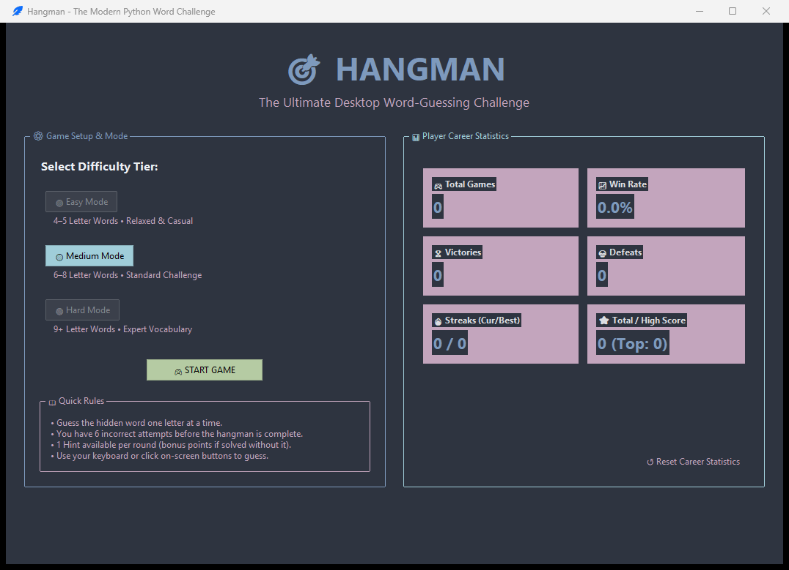
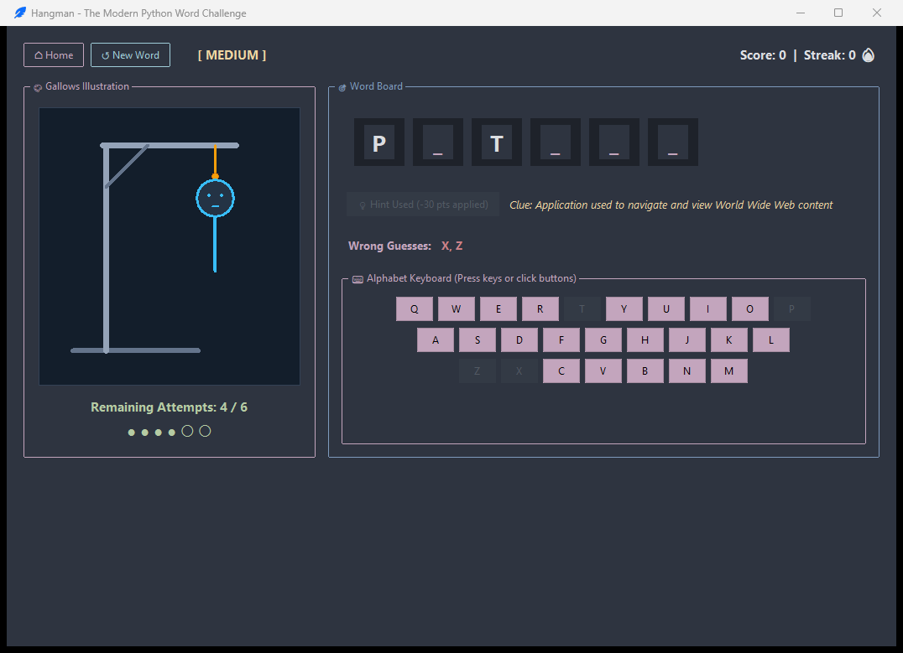
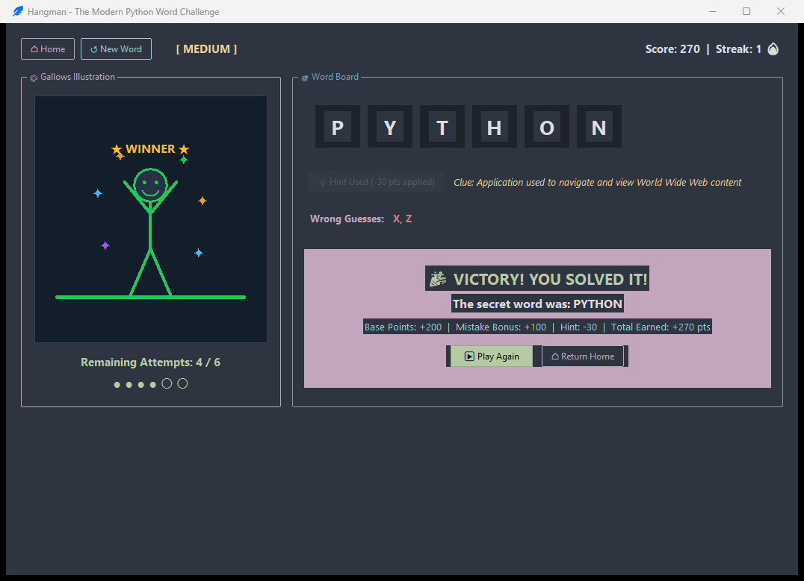
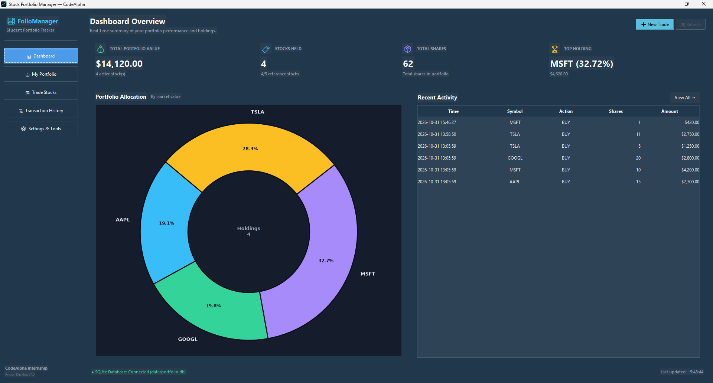
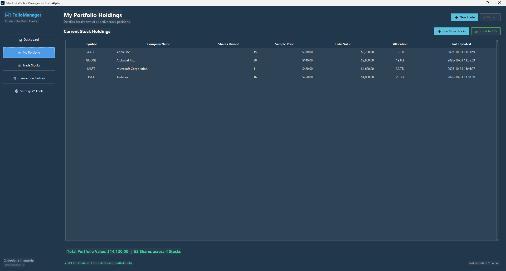
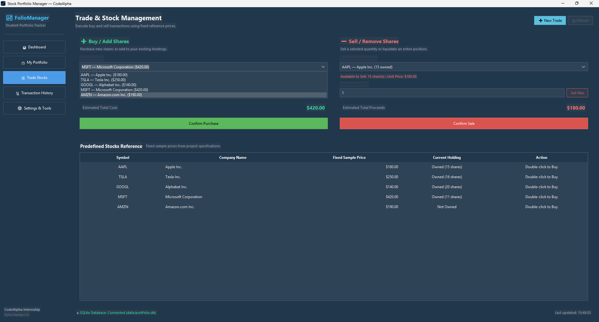
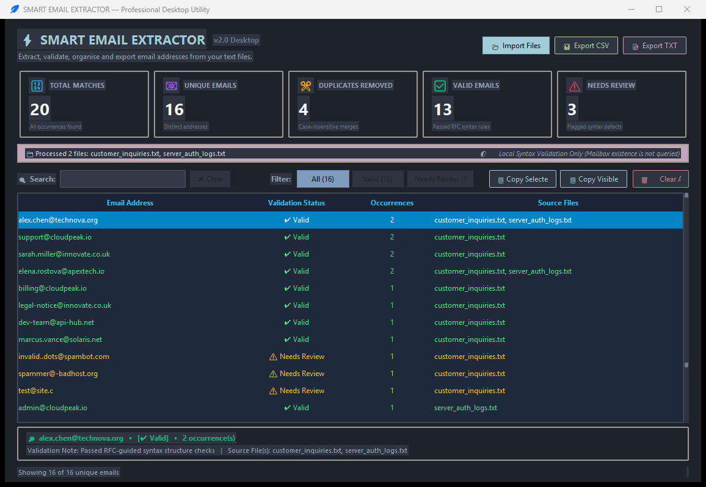
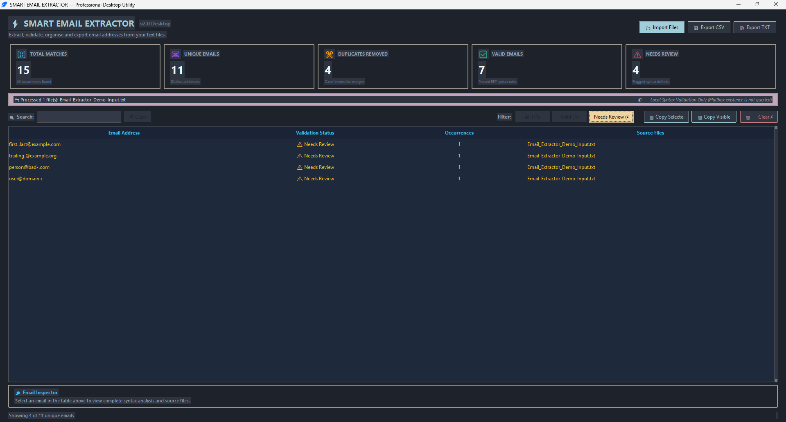
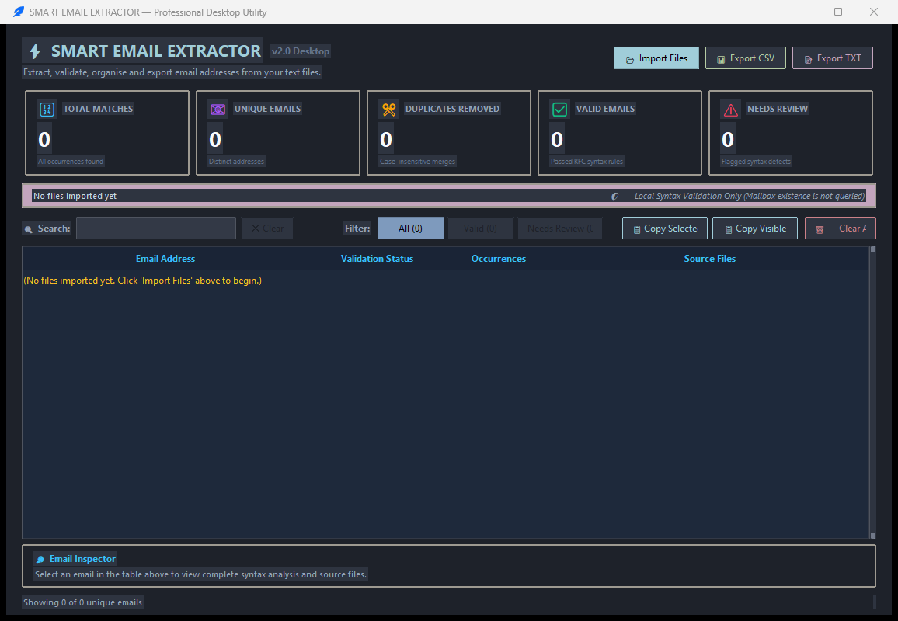

# CodeAlpha Python Programming Projects

A collection of Python desktop applications demonstrating interactive programming, financial data management and text automation.

---

## 🌟 Portfolio Overview

This repository contains three production-quality Python desktop applications developed as part of the **CodeAlpha Python Programming Internship**. Each application elevates fundamental algorithmic and procedural programming concepts into responsive graphical desktop software built with `tkinter`, `ttkbootstrap`, SQLite database storage, dynamic vector graphics, and automated unit testing suites.

```
CodeAlpha_Python/
│
├── Hangman_Game/                # Interactive desktop word game with canvas animations & career stats
├── Stock_Portfolio_Manager/     # Financial tracker with SQLite persistence & Matplotlib donut charts
└── Email_Extractor/             # Text automation utility with 14-rule RFC syntax validation & CSV exports
```

---

## 🎮 Project 1 — Hangman Desktop Game

A modern, polished dark-themed desktop Hangman game featuring progressive vector canvas animations, dual input mechanics (physical keyboard and clickable QWERTY buttons), dynamic difficulty tiers, and persistent career statistics.

### Key Features
* **Dynamic Difficulty Tiers:** 🟢 Easy (4–5 letters), 🟡 Medium (6–8 letters), 🔴 Hard (9+ letters) with automatic previous-word repeat prevention.
* **Dual Input System:** Seamless physical keyboard typing via Tkinter `<Key>` bindings alongside an on-screen QWERTY button grid with color-coded feedback.
* **6-Stage Progressive Canvas Art:** Real-time procedural rendering of gallows, body parts, victory celebration, and defeat reveals using vector paths.
* **Scoring & Career Analytics:** Dynamic score computation based on difficulty and leftover attempts; persistent tracking of win rates, streaks, and high scores in `data/stats.json`.
* **Contextual Hint System:** Educational clue per round with balanced score penalty.

### Technology Stack
* Python 3.10+, `tkinter`, `ttkbootstrap`, Tkinter `Canvas`, `json`, `unittest`

### Visual Previews

| Welcome & Career Dashboard | Active Gameplay View | Victory Celebration |
|:---:|:---:|:---:|
|  |  |  |

📖 **Full Documentation:** [Hangman Game README](Hangman_Game/README.md)

---

## 📈 Project 2 — Stock Portfolio Manager

An offline financial management desktop dashboard that transitions simple portfolio tracking into an enterprise-style tool featuring ACID-compliant SQLite persistence, real-time Matplotlib asset allocation charts, and RFC-compliant CSV audit reporting.

### Key Features
* **Executive Financial Dashboard:** Real-time valuation metrics (Total Portfolio Value, Distinct Stocks, Total Shares, Top Holding).
* **Embedded Donut Visualization:** Dynamic Matplotlib asset allocation donut chart embedded into Tkinter canvas with live recalculation.
* **Buy & Sell Execution Engine:** Strict input validation, quick-increment buttons, and safeguards preventing overselling or selling unowned shares.
* **SQLite Persistence & Audit Trail:** Relational storage in `data/portfolio.db` with parameterized queries and an immutable chronological transaction ledger.
* **RFC-Compliant CSV Exporters:** One-click snapshot and historical transaction exports.

### Technology Stack
* Python 3.10+, `tkinter`, `ttkbootstrap`, `matplotlib`, `sqlite3`, `csv`, `unittest`

### Visual Previews

| Executive Financial Dashboard | Portfolio Holdings Table | Trade Management (Buy/Sell) |
|:---:|:---:|:---:|
|  |  |  |

📖 **Full Documentation:** [Stock Portfolio Manager README](Stock_Portfolio_Manager/README.md)

---

## 📧 Project 3 — Smart Email Extraction Desktop Utility

A high-performance text automation and data extraction utility that ingests unstructured documents, parses candidate email addresses with boundary punctuation cleanup, applies 14 RFC-guided syntax checks, and exports clean datasets.

### Key Features
* **Multi-File Batch Ingestion:** Simultaneously loads multiple text documents (`.txt`, `.log`, `.csv`) with automatic multi-encoding support (`utf-8`, `cp1252`, `latin-1`).
* **Noise & Boundary Stripping:** Eliminates sentence punctuation (trailing dots, commas, quotes, angle brackets `<>`, and `mailto:` prefixes).
* **Case-Insensitive Deduplication:** Unifies duplicate addresses regardless of letter-case variations while retaining the first-seen casing and frequency counts.
* **14-Rule RFC Syntax Diagnostics:** Local validation engine flagging formatting anomalies (consecutive dots, missing TLD, illegal characters) for review.
* **Interactive Results Table:** Instantaneous search-as-you-type filtering, category filter pills (`All`, `Valid`, `Needs Review`), and clipboard export.

### Technology Stack
* Python 3.10+, `tkinter`, `ttkbootstrap`, `re` (Regular Expressions), `csv`, `pathlib`, `unittest`

### Visual Previews

| Extraction Results & Metrics | Category Validation Filter | Initial Empty State |
|:---:|:---:|:---:|
|  |  |  |

📖 **Full Documentation:** [Smart Email Extractor README](Email_Extractor/README.md)

---

## 🛠️ Cross-Project Technology Stack

| Domain | Technologies & Libraries |
| :--- | :--- |
| **Core Programming Language** | Python 3.10+ (Tested extensively on Python 3.14) |
| **Graphical User Interface (GUI)** | Python Standard Library `tkinter` and `ttk` |
| **Modern Desktop Theming** | `ttkbootstrap` (`superhero` and `nord-dark` palettes) |
| **Data Visualization** | `matplotlib` (Embedded TkAgg Figure Canvas) |
| **Data Persistence** | `sqlite3` (ACID relational database), `json` (serialized career stats) |
| **String & Pattern Parsing** | `re` (Regular Expressions), `csv` (RFC 4180 export) |
| **Test Automation Framework** | Python Standard Library `unittest` (78 comprehensive unit & integration tests) |

---

## 📁 Repository Structure

```text
CodeAlpha_Python/
│
├── README.md                          # Root portfolio landing page
├── .gitignore                         # Universal exclusion rules
│
├── Hangman_Game/                      # Project 1: Desktop Hangman Game
│   ├── app.py                         # Application entry point
│   ├── Play_Hangman.bat               # Windows batch launcher
│   ├── requirements.txt               # Dependencies (ttkbootstrap)
│   ├── README.md                      # Detailed project documentation
│   ├── assets/                        # Visual icons and branding
│   ├── data/                          # Persistent JSON statistics directory
│   ├── reference/                     # Original CodeAlpha assignment files
│   ├── screenshots/                   # Application screenshots
│   ├── src/                           # Game logic, statistics, and canvas UI
│   └── tests/                         # Automated test suite (32 tests)
│
├── Stock_Portfolio_Manager/           # Project 2: Stock Portfolio Manager
│   ├── app.py                         # Application entry point
│   ├── Run_Portfolio.bat              # Windows batch launcher
│   ├── Run_Stock_Portfolio_Manager.bat# Alternative launcher
│   ├── requirements.txt               # Dependencies (ttkbootstrap, matplotlib)
│   ├── README.md                      # Detailed project documentation
│   ├── assets/                        # Window icons (.ico, .png)
│   ├── data/                          # SQLite database directory (portfolio.db)
│   ├── reference/                     # Original CodeAlpha assignment files
│   ├── screenshots/                   # Application screenshots
│   ├── src/                           # MVC modules (database, portfolio, charts, ui)
│   └── tests/                         # Automated test suite (12 tests)
│
└── Email_Extractor/                   # Project 3: Smart Email Extractor
    ├── app.py                         # Application entry point
    ├── Run_Email_Extractor.bat        # Windows batch launcher
    ├── requirements.txt               # Dependencies (ttkbootstrap)
    ├── README.md                      # Detailed project documentation
    ├── assets/                        # Static application assets
    ├── data/                          # Fictional demonstration test files
    ├── reference/                     # Original CodeAlpha assignment files
    ├── screenshots/                   # Application screenshots
    ├── src/                           # Extraction engine, file ops, and UI
    └── tests/                         # Automated test suite (34 tests)
```

---

## 🚀 Installation & Getting Started

### 1. Clone the Repository
```powershell
git clone https://github.com/sujith-67/CodeAlpha_Python.git
cd CodeAlpha_Python
```

### 2. Set Up Virtual Environment & Dependencies

Each application is self-contained. You can install all dependencies into a shared environment or into separate project environments:

```powershell
# Create and activate virtual environment
python -m venv .venv
.\.venv\Scripts\Activate.ps1

# Install requirements for all projects
python -m pip install -r Hangman_Game/requirements.txt
python -m pip install -r Stock_Portfolio_Manager/requirements.txt
python -m pip install -r Email_Extractor/requirements.txt
```

---

## 🖥️ Running Applications

### Option A: One-Click Windows Batch Launchers
Each project includes a native Windows `.bat` launcher in its folder:
* **Hangman Game:** Double-click `Hangman_Game\Play_Hangman.bat`
* **Stock Portfolio Manager:** Double-click `Stock_Portfolio_Manager\Run_Portfolio.bat`
* **Email Extractor:** Double-click `Email_Extractor\Run_Email_Extractor.bat`

### Option B: Terminal Commands
```powershell
# Run Hangman Game
cd Hangman_Game
python app.py

# Run Stock Portfolio Manager
cd Stock_Portfolio_Manager
python app.py

# Run Smart Email Extractor
cd Email_Extractor
python app.py
```

---

## 🧪 Automated Testing

The repository contains **78 automated unit and integration tests** across the three applications:

| Application | Test Directory | Command | Test Count |
| :--- | :--- | :--- | :---: |
| **Hangman Game** | `Hangman_Game/tests/` | `cd Hangman_Game; python -m unittest discover -s tests -v` | **32 tests** |
| **Stock Portfolio Manager** | `Stock_Portfolio_Manager/tests/` | `cd Stock_Portfolio_Manager; python -m unittest discover -s tests -v` | **12 tests** |
| **Email Extractor** | `Email_Extractor/tests/` | `cd Email_Extractor; python -m unittest discover -s tests -v` | **34 tests** |
| **Total Test Suite** | — | — | **78 tests (100% Passing)** |

---

## ⚠️ Project Limitations & Scope Notes

* **Stock Portfolio Pricing:** Stock prices are fixed sample prices (`AAPL: $180`, `TSLA: $250`, `GOOGL: $140`, `MSFT: $420`, `AMZN: $190`) defined in accordance with CodeAlpha task specifications. Live financial API integrations (e.g., Yahoo Finance) are omitted to ensure offline, reproducible execution.
* **Email Validation Scope:** Syntax validation follows RFC-guided structural rules only. It does not verify active mailbox existence, DNS MX records, or SMTP deliverability.
* **Local Data Storage:** All runtime databases and persistent state (`data/portfolio.db`, `data/stats.json`) run on the local client machine without cloud account synchronization.

---

## 👤 Author Information

* **Author:** Sujith T
* **Degree:** Bachelor of Technology (B.Tech)
* **Department:** Artificial Intelligence and Data Science
* **Institution:** KPR Institute of Engineering and Technology (Autonomous)
* **GitHub Profile:** [sujith-67](https://github.com/sujith-67)
* **Internship:** CodeAlpha Virtual Internship Program — Python Programming
