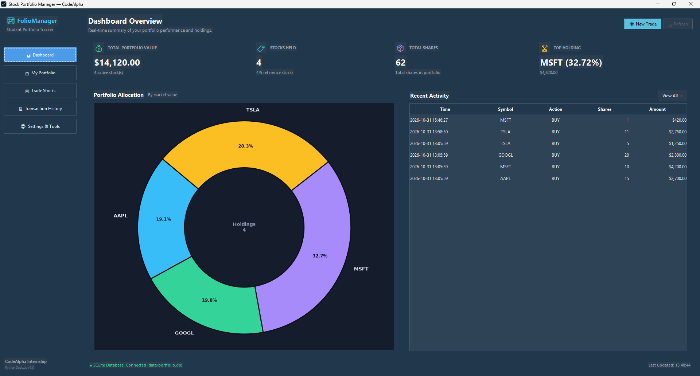
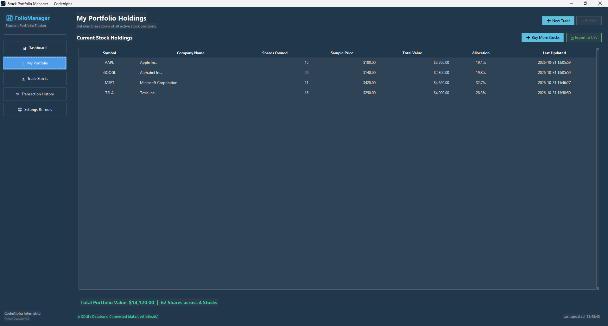
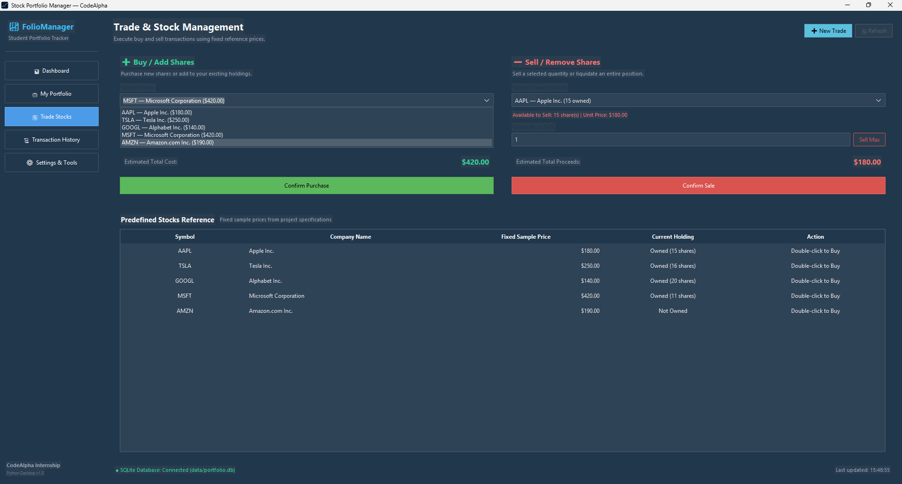
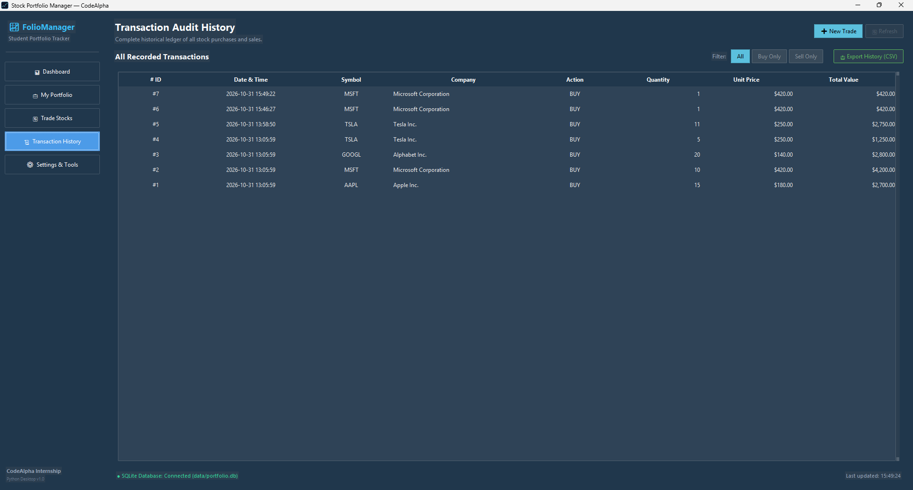
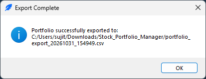

# 📈 Stock Portfolio Manager — Python Desktop Application

A modern, polished, and beginner-friendly **Stock Portfolio Manager** desktop application developed in Python with Tkinter, `ttkbootstrap`, and SQLite. Built as an advanced enhancement to the **CodeAlpha Python Programming Internship (Task 2: Stock Portfolio Tracker)**, this project transitions the original console-based text script into a full-featured financial management dashboard featuring ACID-compliant SQLite persistence, interactive Matplotlib asset allocation visualization, dynamic buy/sell trade execution, and RFC-compliant CSV report exports.

---

## 🎯 1. Project Objectives

* **Financial Application Architecture:** Transition a basic CLI script into an event-driven desktop dashboard adhering to Model-View-Controller (MVC) separation of concerns.
* **ACID Data Persistence:** Replace hardcoded runtime variables with a permanent SQLite database schema enforcing unique stock tickers and audit trail immutability.
* **Interactive Data Visualization:** Embed interactive Matplotlib donut charts directly into Tkinter canvas widgets to depict real-time asset allocation percentages.
* **Strict Transaction Validation:** Enforce positive integer quantities, confirm trade dialogs, and prevent overselling or liquidation of unowned positions.
* **Audit & Regulatory Export:** Provide RFC-compliant CSV snapshot and chronological ledger exports for external auditing and spreadsheet analysis.
* **Offline Determinism:** Utilize fixed reference pricing to ensure an offline, reliable student engineering and evaluation environment.

---

## ✨ 2. Main Features

### 📊 Modern Financial Dashboard
* **Real-Time Summary Metrics:**
  * **Total Portfolio Value ($):** Real-time sum of all active stock positions.
  * **Stocks Held:** Count of distinct equities currently owned.
  * **Total Shares:** Aggregate share count across all positions.
  * **Top Allocation:** Automatically highlights your highest-value holding and its percentage weight.
* **Asset Allocation Donut Chart:**
  * Embedded Matplotlib Donut Chart visualizing asset weights dynamically.
  * Updates in real time whenever shares are bought, sold, or reset.
  * Displays an elegant placeholder when zero positions are held.
* **Recent Activity Feed:** Timestamped feed displaying the latest 6 transactions with color-coded badges (`BUY` in green, `SELL` in red).

### 🔄 Stock Management & Trading
* **Predefined Reference Stock Catalog:**
  * `AAPL` — Apple Inc. ($180.00)
  * `TSLA` — Tesla Inc. ($250.00)
  * `GOOGL` — Alphabet Inc. ($140.00)
  * `MSFT` — Microsoft Corporation ($420.00)
  * `AMZN` — Amazon.com Inc. ($190.00)
* **Buy / Add Shares:**
  * Dropdown selector for available stocks.
  * Quick quantity increment buttons (`+1`, `+5`, `+10`).
  * Live total cost estimate as quantity is entered.
  * Increments existing positions seamlessly without duplicate records.
* **Sell / Liquidate Shares:**
  * Filtered strictly to currently owned stocks.
  * Displays current shares owned and execution price.
  * **"Sell Max"** button to liquidate an entire position in one click.
  * **Overselling Safeguard:** Enforces validation to prevent selling more shares than owned.
* **Input Validation & Confirmations:**
  * Strict validation rejecting non-numeric, decimal, zero, or negative inputs.
  * Modal confirmation dialogs before executing any trade.

### 💼 Portfolio Holdings Table
* Formatted table displaying: Ticker Symbol, Company Name, Shares Owned, Reference Price, Position Value, Portfolio Allocation (%), and Last Updated Timestamp.
* Summary footer displaying total portfolio valuation.

### 📜 Transaction Audit History Ledger
* Immutable audit trail recording every trade: Transaction ID, Timestamp, Symbol, Company Name, Action (`BUY` / `SELL`), Quantity, Execution Price, and Total Value.
* Filter ledger by trade type: **All**, **Buy Only**, or **Sell Only**.

### 🗄️ SQLite Data Persistence
* Automatic database creation on first launch (`data/portfolio.db`).
* Parameterized SQL queries preventing SQL injection and data corruption.
* Holdings table enforces unique stock symbols (`PRIMARY KEY`).

### 📥 RFC-Compliant CSV Export
* **Export Portfolio Snapshot:** Generates a structured `.csv` report of all holdings and total valuation.
* **Export Transaction Ledger:** Generates a complete chronological `.csv` history of all trades.

---

## 📸 3. Screenshots

| Financial Dashboard & Allocation Chart | Portfolio Holdings Table |
|:---:|:---:|
|  |  |

| Trade Execution (Buy & Sell) | Transaction Audit History |
|:---:|:---:|
|  |  |

| CSV Export Confirmation |
|:---:|
|  |

---

## 🛠️ 4. Technologies Used

* **Language:** Python 3.10+ (tested on Python 3.14)
* **Desktop GUI Engine:** Python Standard Library `tkinter` and `ttk`
* **Modern Theming Engine:** `ttkbootstrap` (Superhero dark navy theme)
* **Embedded Visualization:** `matplotlib` (Embedded TkAgg backend)
* **Relational Database:** Python Standard Library `sqlite3`
* **Export Engine:** Python Standard Library `csv`
* **Test Automation:** Python Standard Library `unittest`

---

## 🏛️ 5. Application Architecture

The application implements a clean Model-View-Controller (MVC) architectural pattern:

```
┌────────────────────────────────────────────────────────┐
│                   app.py (Launcher)                    │
└───────────────────────────┬────────────────────────────┘
                            │
              ┌─────────────┴─────────────┐
              ▼                           ▼
┌───────────────────────────┐ ┌───────────────────────────┐
│     src/ui.py (View)      │ │  src/charts.py (View)     │
│ - StockPortfolioApp       │ │ - Matplotlib Donut Chart  │
│ - Dashboard, Holdings,    │ │ - Embedded FigureCanvas   │
│   Trade & History views   │ │ - Real-time Slice Re-draw │
└─────────────┬─────────────┘ └─────────────▲─────────────┘
              │                             │
              ▼                             │
┌───────────────────────────────────────────┴─────────────┐
│             src/portfolio.py (Controller)               │
│ - PortfolioManager                                      │
│ - Fixed Sample Pricing Model                            │
│ - Buy / Sell Trade Validation & Overselling Guards      │
│ - Portfolio Valuation & Percentage Allocation           │
│ - RFC-Compliant CSV Exporters                           │
└───────────────────────────┬─────────────────────────────┘
                            │
                            ▼
┌─────────────────────────────────────────────────────────┐
│               src/database.py (Model)                   │
│ - DatabaseManager (SQLite Context Managers)             │
│ - Schema Definition: 'holdings' and 'transactions'      │
│ - Parameterized Query Execution & Audit Logging         │
└─────────────────────────────────────────────────────────┘
```

---

## 📁 6. Directory Structure

```text
Stock_Portfolio_Manager/
│
├── assets/
│   ├── icon.ico                 # High-resolution application window icon
│   └── icon.png                 # PNG format logo
│
├── data/
│   └── .gitkeep                 # Directory for SQLite database (portfolio.db generated at runtime)
│
├── reference/
│   ├── stock_portfolio_original.py.PY   # Original CodeAlpha Task 2 script
│   ├── stock portfolio.txt              # Byte-verified text assignment
│   └── CodeAlpha_Task_Instructions.pdf  # Official task guidelines
│
├── screenshots/                 # Application interface screenshots
│   ├── dashboard.png
│   ├── export_confirmation.png
│   ├── portfolio_holdings.png
│   ├── trade_management.png
│   └── transaction_history.png
│
├── src/
│   ├── __init__.py
│   ├── charts.py                # Embedded Matplotlib donut chart
│   ├── database.py              # SQLite operations & context managers
│   ├── portfolio.py             # Business logic, trading rules, CSV exports
│   └── ui.py                    # Multi-view Tkinter & ttkbootstrap interface
│
├── tests/
│   ├── __init__.py
│   ├── test_database.py         # Unit tests for SQLite persistence & schema
│   └── test_portfolio.py        # Unit tests for trading logic & calculations
│
├── app.py                       # Main application entry point
├── Run_Portfolio.bat            # Windows batch launcher
├── Run_Stock_Portfolio_Manager.bat # Backward-compatible launcher
├── requirements.txt             # Python dependencies
├── .gitignore                   # Project-level Git exclusion rules
└── README.md                    # Comprehensive documentation
```

---

## 📥 7. Installation Instructions

1. **Navigate to the project directory:**
   ```powershell
   cd Stock_Portfolio_Manager
   ```

2. **(Recommended) Create and activate a virtual environment:**
   ```powershell
   python -m venv .venv
   .\.venv\Scripts\Activate.ps1
   ```

3. **Install dependencies:**
   ```powershell
   python -m pip install -r requirements.txt
   ```

---

## 🚀 8. Running Instructions

### Direct Python Execution
```powershell
python app.py
```

### Windows Batch Launcher
Double-click `Run_Portfolio.bat` (or `Run_Stock_Portfolio_Manager.bat`) from Windows Explorer or run from terminal:
```cmd
Run_Portfolio.bat
```
The launcher sets the working directory, verifies Python availability, and runs the application cleanly.

---

## 🧪 9. Testing Instructions

The project includes an automated test suite executed against disposable in-memory and temporary SQLite databases, ensuring zero interference with production records.

Run tests using `unittest`:
```powershell
python -m unittest discover -s tests -v
```

### Verified Test Scenarios
* **Database Operations (`test_database.py`):** Schema initialization, adding new and existing shares, partial and full share liquidation, transaction logging, query limit parameters, database persistence across instances, and database reset.
* **Business Logic (`test_portfolio.py`):** Stock catalog and sample pricing, input quantity sanitization (non-numeric, negative, zero), buy logic and stock verification, sell logic and overselling prevention, portfolio summary computation, allocation percentage arithmetic, and RFC-compliant CSV generation.

---

## ⚠️ 10. Limitations

* **Fixed Sample Pricing Model:** In accordance with the original CodeAlpha internship project specifications, stock prices are fixed sample prices (`AAPL: $180`, `TSLA: $250`, `GOOGL: $140`, `MSFT: $420`, `AMZN: $190`) to provide an offline, reproducible student testing environment. Live market financial APIs (e.g., Yahoo Finance, Alpha Vantage) are intentionally omitted.
* **No Real Brokerage Connectivity:** This software is an educational simulation tool for portfolio tracking and does not connect to live stock brokerages or execute actual financial transactions.
* **Local SQLite Scope:** Data is persisted in a local SQLite file (`data/portfolio.db`) designed for single-user desktop access rather than multi-tenant enterprise clustering.
